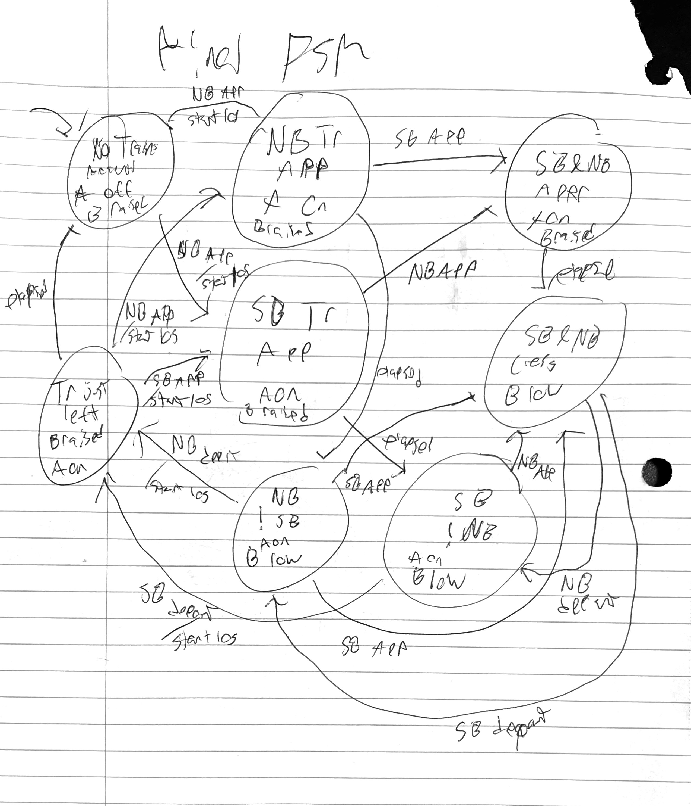
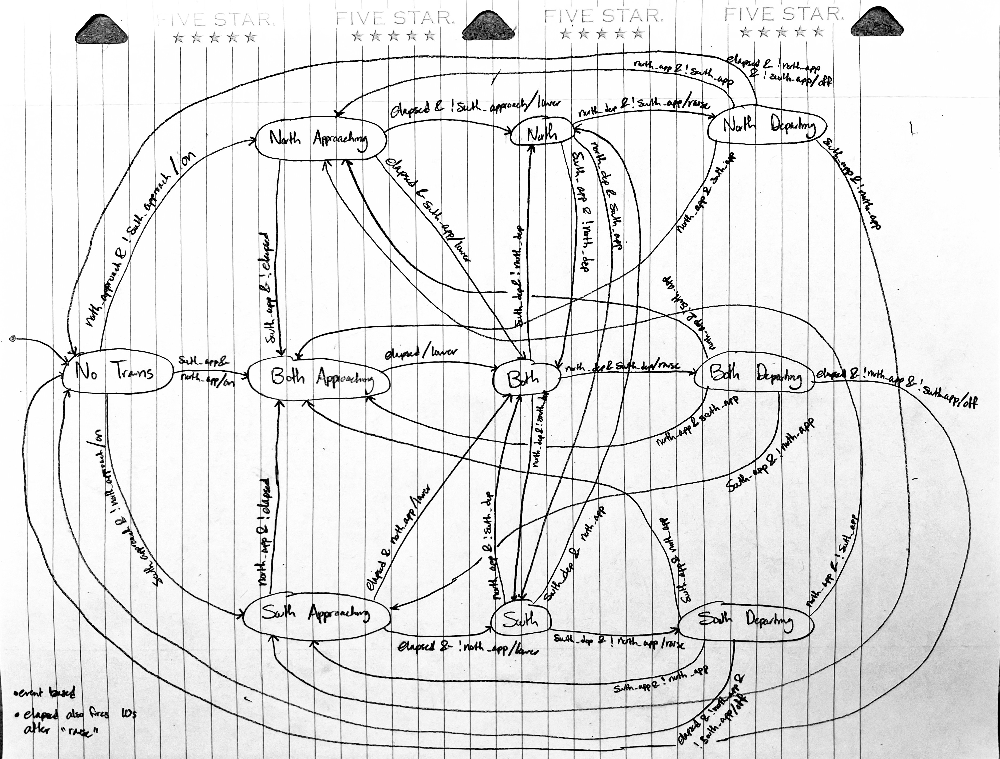

# Lab 9 Documentation
## Invariants
- The arriving and departing sensors are placed sufficiently far from the railroad crossing that the arms will have lowered by the time the train reaches the intersection.
- The train won't be moving fast enough to break the 10 second deadline between the lights flashing and the arms lowering.
- The departing sensor is triggered by the tail end of the train (when weight is no longer detected) rather than the front end of the train (so that long trains don't remain in in the intersection when the departing sensor is triggered).
- Trains are spaced with sufficient distance such that a second train on the same track won't trigger an arriving signal before the prior train has triggered the departing signal.
- The sensors are reliable and won't be disrupted by environmental conditions.
- Passersby will heed the alarms and not bypass the arms.

## Varying Invariants (On Example FSM)
- The invariant "an approach signal will always preceed a depart signal" would be broken in the following sequence of events:
  1. On reset, we enter the `idle` state
  2. An nb_approach is received to enter the `ringing, arms up` state.
  3. In this state or the next two states (`ringing, arms up`, `ringing, arms down`, or `ringing, arms_up (2nd time)`), a southbound train approaches and triggers the `sb_approach` signal.
  4. The northbound train exits the intersection and triggers the `nb_depart` signal.
  5. The southbound train exits the intersection and triggers the `sb_depart` signal. From the perspective of this FSM, an invariant has been violated - a depart signal arrived before an arrival signal - because the FSM missed the arrival signal.

## Check Your Work
### FSM #1

  - A counterexample for this FSM occurs when it's in the `idle` state and both a northbound and a southbound train arrive at the same time (meaning `nb_approach` and `sb_approach` are present simultaneously). If this happens, the FSM will lose track of one of the trains, the arms will raise when the train it's tracking departs, and then, when the second train departs, a depart signal will arrive before an arrival signal from the perspective of the FSM since it lost track of the corresponding arrival signal.

### FSM #2

  - We we unable to find a counterexample for this FSM.